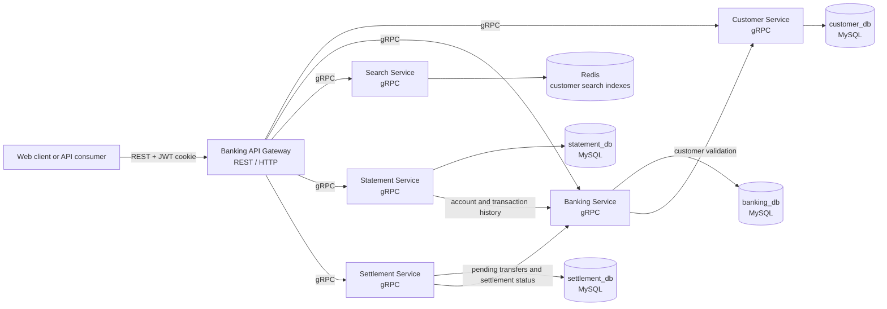

# Banking Customer and Fund Transfer Platform

A six-service banking platform that provides customer management, account and
fund-transfer operations, customer search, account statements, and settlement
processing. The NestJS API Gateway is the public HTTP entry point; the backend
services communicate over gRPC and maintain separate data stores.

## 1. Project Overview

The repository is organized as six independent NestJS projects, each with its
own `package.json`, lockfile, environment configuration, and test commands.
The API Gateway exposes REST endpoints and coordinates the five backend
services. Customer, Banking, Statement, and Settlement data is stored in
separate MySQL databases. Search uses Redis indexes and customer hashes.

## 2. Features and Functionalities

- Create and query customers, list customers with filters and pagination, and
  verify customer credentials. Customer passwords are stored as bcrypt hashes.
- Create accounts after validating the customer with Customer Service.
- Make transfers with idempotency keys, account-balance updates, and transfer
  audit and ledger entries.
- Search customers by case-insensitive prefixes across name, mobile, city, and
  state using Redis.
- Generate paginated account statements from Banking Service transaction
  history, and export statements as CSV or PDF.
- Create and process settlement jobs, track transaction outcomes and audit
  events, and retrieve failed-transaction reports.
- Authenticate Gateway requests with JWTs stored in an HTTP-only cookie.
- Validate API requests and publish the Gateway's interactive Swagger
  documentation.

## 3. Technology Stack

- **Runtime and framework:** Node.js, TypeScript, NestJS
- **Service communication:** gRPC with Protocol Buffers, `@grpc/grpc-js`, and
  `@grpc/proto-loader`
- **Relational persistence:** MySQL, TypeORM, and `mysql2`
- **Search storage:** Redis with `ioredis`
- **Authentication:** JWT, Passport, and bcrypt
- **API documentation:** Swagger / OpenAPI through NestJS Swagger
- **Statements:** PDFKit for PDF exports and CSV export support
- **Testing and quality:** Jest, Supertest, and Oxlint

The Search Service README specifies Node.js 22.22.3+ or 24.15+; use a
compatible Node.js installation for the workspace.

## 4. Microservices Architecture

The Gateway is the only service exposing the platform's public REST API.
Backend services expose gRPC APIs and are not intended to receive browser REST
requests directly. Banking Service validates new account owners through
Customer Service. Statement Service reads accounts and transaction history
from Banking Service. Settlement Service reads pending transfers and updates
their settlement status through Banking Service.

## 5. Architecture Diagram



## 6. Description of Each Microservice

| Project | Responsibility |
| --- | --- |
| [`banking-api-gateway`](./banking-api-gateway/) | REST API, request validation, Swagger UI, JWT-cookie authentication, and gRPC clients for all backend services. |
| [`customer-service`](./customer-service/) | Customer records, credential verification, customer filtering and pagination, and customer database migrations. |
| [`banking-service`](./banking-service/) | Accounts, fund transfers, transfer audit records, balance ledger, and gRPC operations used by Statement and Settlement Services. |
| [`search-service`](./search-service/) | Redis-backed customer prefix search over indexed customer fields; exposes a gRPC search operation. |
| [`statement-service`](./statement-service/) | Statement generation and retrieval, paginated transactions, and CSV/PDF exports; uses Banking Service history over gRPC. |
| [`settlement-service`](./settlement-service/) | Settlement jobs, per-transfer outcomes and audit logs, failure reports, and scheduled settlement processing. |

## 7. Communication Flow (REST API Gateway and gRPC)

1. A client calls the Gateway over HTTP using the `/api` route prefix.
2. The Gateway validates request DTOs, applies its authentication guard, and
   forwards the operation to the corresponding gRPC service.
3. Customer, Banking, Search, Statement, and Settlement Services handle their
   domain operation and access their own persistence layer.
4. Banking Service calls Customer Service to validate a customer when creating
   an account. Statement and Settlement Services call Banking Service for
   account/transfer data and settlement updates, respectively.
5. gRPC failures are translated to HTTP errors by the Gateway's exception
   filter.

The Protocol Buffer definitions are in each service's `proto` directory.
Banking Service uses Customer Service's proto file via
`CUSTOMER_PROTO_PATH`; Statement Service uses Banking Service's proto file via
`BANKING_PROTO_PATH`. The Gateway maintains copies of the backend contracts in
`banking-api-gateway/src/proto`.

## 8. Database Architecture

Each MySQL-backed service uses its own database and TypeORM migrations;
automatic schema synchronization is disabled.

| Database / store | Owner | Main persisted data |
| --- | --- | --- |
| `customer_db` | Customer Service | Customer records, status, timestamps, and password hashes. |
| `banking_db` | Banking Service | Accounts, transfers, transfer audit entries, account-balance ledger entries, and settlement status. |
| `statement_db` | Statement Service | Generated statements and their transaction rows. |
| `settlement_db` | Settlement Service | Settlement jobs, transfer settlement results, and settlement audit logs. |
| Redis | Search Service | Customer hashes and sorted-set indexes used for prefix search; this is not a MySQL database. |

The Banking Service balance-ledger migration records each account's current
balance as a baseline when the ledger is activated. It does not reconstruct
older transfer history or historical balances. Apply it before relying on
statements over ledger-backed history.

## 9. Project Folder Structure

```text
banking-platform/
├── banking-api-gateway/
│   ├── src/                 # REST controllers, auth, gRPC clients, proto copies
│   └── test/
├── customer-service/
│   ├── proto/
│   ├── src/customer/        # Customer gRPC API and domain logic
│   ├── src/database/        # TypeORM configuration and migrations
│   └── test/
├── banking-service/
│   ├── proto/
│   ├── src/accounts/
│   ├── src/transfers/
│   ├── src/ledger/
│   ├── src/database/
│   └── test/
├── search-service/
│   ├── proto/
│   ├── src/redis/
│   ├── src/search/
│   ├── scripts/             # Seed and benchmark utilities
│   └── test/
├── statement-service/
│   ├── proto/
│   ├── src/statement/
│   ├── src/banking/
│   ├── src/database/
│   └── test/
└── settlement-service/
    ├── proto/
    ├── src/scheduler/
    ├── src/banking-client/
    ├── src/settlement-job/
    ├── src/settlement-transaction/
    ├── src/settlement-audit-log/
    ├── src/reports/
    └── test/
```

Each project also contains its own `package.json`, `package-lock.json`,
TypeScript/Nest configuration, and service-local `.env`.

## 10. Prerequisites and Installation

Install the following on Windows:

- Node.js and npm (see the Node.js version note above).
- MySQL Server and a MySQL client such as MySQL Workbench or `mysql.exe`.
- Redis, available locally or through Docker Desktop / WSL2.
- Git, if cloning the repository.

Open PowerShell in the repository root. Install dependencies separately for
each project; there is no root package manifest:

```powershell
$services = @(
  'banking-api-gateway',
  'customer-service',
  'banking-service',
  'search-service',
  'statement-service',
  'settlement-service'
)

foreach ($service in $services) {
  Push-Location $service
  npm ci
  if ($LASTEXITCODE -ne 0) {
    Pop-Location
    throw "npm ci failed in $service"
  }
  Pop-Location
}
```

Service-specific environment files are located in each project directory.
Review them locally, configure the values for your machine, and keep passwords,
JWT signing secrets, and observability keys private. Do not copy secret values
into this README or commit local credentials.

## 11. Environment Variable Configuration

Configure these variables in the corresponding service's `.env` file. The
descriptions below reflect configuration read by the application; do not
publish actual credential values.

| Service | Variables |
| --- | --- |
| API Gateway | `PORT` (HTTP listener; default `3000`), `CORS_ORIGIN` (comma-separated allowed origins), `CUSTOMER_GRPC_HOST` / `CUSTOMER_GRPC_PORT`, `BANKING_GRPC_HOST` / `BANKING_GRPC_PORT`, `SEARCH_GRPC_HOST` / `SEARCH_GRPC_PORT`, `STATEMENT_GRPC_HOST` / `STATEMENT_GRPC_PORT`, `SETTLEMENT_GRPC_HOST` / `SETTLEMENT_GRPC_PORT`, `JWT_SECRET` (required), `JWT_EXPIRES_IN` (default `15m`). |
| Customer Service | `DB_HOST`, `DB_PORT`, `DB_USERNAME`, `DB_PASSWORD`, `DB_DATABASE` (use `customer_db`), `GRPC_PORT` (required). |
| Banking Service | `DB_HOST`, `DB_PORT`, `DB_USERNAME`, `DB_PASSWORD`, `DB_DATABASE` (must be `banking_db`), `CUSTOMER_SERVICE_URL` (default `127.0.0.1:50051`), `CUSTOMER_PROTO_PATH` (defaults to `../customer-service/proto/customer.proto` when run from this service directory). |
| Search Service | `REDIS_HOST` / `REDIS_PORT` (defaults `localhost:6379`), `GRPC_HOST` / `GRPC_PORT` (defaults `0.0.0.0:50053`). |
| Statement Service | `DB_HOST`, `DB_PORT`, `DB_USERNAME`, `DB_PASSWORD`, `DB_DATABASE` (default `statement_db`), `BANKING_SERVICE_URL` (default `localhost:50052`), `BANKING_PROTO_PATH` (required; for a service-directory working directory, use `..\banking-service\proto\banking.proto`), `STATEMENT_GRPC_URL` (default `0.0.0.0:50056`). |
| Settlement Service | `DB_HOST`, `DB_PORT`, `DB_USERNAME`, `DB_PASSWORD`, `DB_DATABASE` (default `settlement_db`), `GRPC_PORT` (default `50055`), `BANKING_SERVICE_URL` (default `localhost:50052`), `SETTLEMENT_TIMEZONE` (default `Asia/Kolkata`), `SETTLEMENT_RETRY_BASE_DELAY_MS` (default `1000`). |

`OBSERVE_APP_KEY` and `OBSERVE_APP_SECRET` are optional observability
configuration variables where NestJS Observe is enabled. The settlement
scheduler currently uses a fixed batch size of 100 and a maximum of 3 retries;
the `SETTLEMENT_BATCH_SIZE` and `SETTLEMENT_MAX_RETRIES` entries in the local
environment file do not override those source-code constants.

The Gateway uses `JWT_SECRET` to sign and verify tokens. Generate a private
value locally rather than reusing a checked-in example:

```powershell
node -e "console.log(require('node:crypto').randomBytes(32).toString('base64url'))"
```

## 12. Database Creation and Migration Instructions

Create the four databases in MySQL before applying migrations. For example,
connect from PowerShell with a password prompt:

```powershell
mysql -u root -p
```

Then run the following SQL in the MySQL client:

```sql
CREATE DATABASE customer_db CHARACTER SET utf8mb4 COLLATE utf8mb4_unicode_ci;
CREATE DATABASE banking_db CHARACTER SET utf8mb4 COLLATE utf8mb4_unicode_ci;
CREATE DATABASE statement_db CHARACTER SET utf8mb4 COLLATE utf8mb4_unicode_ci;
CREATE DATABASE settlement_db CHARACTER SET utf8mb4 COLLATE utf8mb4_unicode_ci;
```

Set each service's `DB_HOST`, `DB_PORT`, `DB_USERNAME`, `DB_PASSWORD`, and
`DB_DATABASE` to match your local MySQL setup. In four separate PowerShell
commands from the repository root, apply the migrations:

```powershell
Push-Location .\customer-service
npm run migration:run
Pop-Location

Push-Location .\banking-service
npm run migration:run
Pop-Location

Push-Location .\statement-service
npm run migration:run
Pop-Location

Push-Location .\settlement-service
npm run migration:run
Pop-Location
```

The migrations create and evolve each service's schema; application startup
does not synchronize schemas automatically. Banking migrations include the
balance ledger and transfer settlement status required by Statement and
Settlement processing. Review migrations before applying them to databases
containing data. Each service also provides `migration:show`; Customer,
Banking, Statement, and Settlement provide `migration:generate`, and all four
provide `migration:revert` for the latest migration.

## 13. Redis Setup

Search Service connects to `localhost:6379` by default. With Docker Desktop
installed, start a local Redis server from PowerShell:

```powershell
docker run --name banking-platform-redis -p 6379:6379 -d redis
```

Check that it is reachable:

```powershell
docker exec banking-platform-redis redis-cli ping
```

The expected response is `PONG`. Set `REDIS_HOST` and `REDIS_PORT` in
`search-service/.env` if Redis is hosted elsewhere. To stop the container, run
`docker stop banking-platform-redis`; to start it again, run
`docker start banking-platform-redis`.

## 14. How to Run All Six Services

Complete dependency installation, local environment configuration, database
creation, migrations, and Redis setup first. Start each service in its own
PowerShell terminal, with the working directory at the repository root:

| Terminal | Commands |
| --- | --- |
| 1 — Customer | `Set-Location .\customer-service` then `npm run start:dev` |
| 2 — Banking | `Set-Location .\banking-service` then `npm run start:dev` |
| 3 — Search | `Set-Location .\search-service` then `npm run start:dev` |
| 4 — Statement | `Set-Location .\statement-service` then `npm run start:dev` |
| 5 — Settlement | `Set-Location .\settlement-service` then `npm run start:dev` |
| 6 — API Gateway | `Set-Location .\banking-api-gateway` then `npm run start:dev` |

Start the backend services before the Gateway so its gRPC clients can connect.
The Gateway's `STATEMENT_GRPC_PORT` must point to the Statement Service's
listener port.

## 15. API Gateway URL and Service Ports

The default Gateway URL is `http://localhost:3000`; Swagger UI is at
`http://localhost:3000/api/docs`.

| Service | Protocol | Local listener |
| --- | --- | --- |
| Banking API Gateway | HTTP | `localhost:3000` |
| Customer Service | gRPC | `localhost:50051` |
| Banking Service | gRPC | `localhost:50052` |
| Search Service | gRPC | `localhost:50053` |
| Settlement Service | gRPC | `localhost:50055` |
| Statement Service | gRPC | `localhost:50056` |

The Gateway's source fallback for `STATEMENT_GRPC_PORT` is `50054`, while
Statement Service listens on `50056` by default. The checked-in local Gateway
configuration targets `50056`; ensure this setting matches your actual
Statement Service address.

## 16. Authentication and JWT Usage

`POST /api/auth/login` accepts customer credentials. On successful
verification, the Gateway signs a JWT and sets it in an `access_token`
HTTP-only cookie; the response body contains a success message rather than the
token. The cookie is `SameSite=Lax` and is marked `Secure` when
`NODE_ENV=production`. Token lifetime is configured with `JWT_EXPIRES_IN`
(default `15m`); `JWT_SECRET` is required and must be kept private.

The Gateway extracts authentication from the cookie, not from an
`Authorization: Bearer` header. Keep the cookie in the client session for
subsequent protected requests. For browser clients making cross-origin calls,
configure `CORS_ORIGIN` and send credentials. `POST /api/auth/logout` clears
the cookie. Health and login are public; customer creation is also public.
Other customer, account, transfer, search, statement, and settlement routes
require authentication.

## 17. API Documentation Reference

OpenAPI / Swagger UI is served by the Gateway at
[`/api/docs`](http://localhost:3000/api/docs). The HTTP routes implemented by
the Gateway are:

| Method | Route | Purpose |
| --- | --- | --- |
| `GET` | `/api/health` | Gateway health check. |
| `POST` | `/api/auth/login` | Verify credentials and set the JWT cookie. |
| `POST` | `/api/auth/logout` | Clear the authenticated cookie. |
| `POST` | `/api/customers` | Create a customer. |
| `GET` | `/api/customers` | List customers. |
| `GET` | `/api/customers/:id` | Retrieve a customer. |
| `GET` | `/api/search/customers?q=...` | Search customers. |
| `POST` | `/api/accounts` | Create an account. |
| `GET` | `/api/accounts/:id` | Retrieve an account. |
| `POST` | `/api/transfers` | Create a transfer. |
| `GET` | `/api/transfers/:id` | Retrieve a transfer. |
| `POST` | `/api/statements` | Generate an account statement. |
| `GET` | `/api/statements/:id` | Retrieve a statement and its transactions. |
| `GET` | `/api/statements/:id/export/csv` | Download a statement as CSV. |
| `GET` | `/api/statements/:id/export/pdf` | Download a statement as PDF. |
| `POST` | `/api/settlements` | Create a settlement job. |
| `POST` | `/api/settlements/:id/process` | Process a settlement job. |
| `GET` | `/api/settlements/:id` | Retrieve a settlement job. |
| `GET` | `/api/settlements/:id/report` | Retrieve a settlement failure report. |

Backend gRPC contracts are documented in
`customer-service/proto/customer.proto`,
`banking-service/proto/banking.proto`,
`search-service/proto/search.proto`,
`statement-service/proto/statement.proto`, and
`settlement-service/proto/settlement.proto`.

## 18. Unit Test Execution Commands

Run each command from the corresponding service directory:

| Service | Unit tests | End-to-end tests |
| --- | --- | --- |
| API Gateway | `npm test` | `npm run test:e2e` |
| Customer Service | `npm test` | `npm run test:e2e` |
| Banking Service | `npm test` | `npm run test:e2e` |
| Search Service | `npm test` | No `test:e2e` script is defined. |
| Statement Service | `npm test` | `npm run test:e2e` |
| Settlement Service | `npm test` | `npm run test:e2e` |

The repository defines a separate Jest configuration within each project;
there is no root-level test command.

## 19. Settlement Scheduler Details

Settlement Service schedules a daily settlement run at **1:00 AM in
`Asia/Kolkata`**. The cron timezone is specified in the scheduler. The
`SETTLEMENT_TIMEZONE` variable defaults to `Asia/Kolkata` for settlement job
context; changing it does not change the cron decorator's configured timezone.

The scheduler requests pending Banking Service transfers in pages of 100 and
advances through the Banking Service transfer-ID cursor. Each transfer update
is retried up to three times, with exponential delay based on
`SETTLEMENT_RETRY_BASE_DELAY_MS` (default `1000` milliseconds). Job status and
per-transfer attempts are recorded in Settlement Service's database and audit
log. Duplicate jobs for the same job date are suppressed. A job can also be
created and processed through the Gateway's settlement endpoints.
