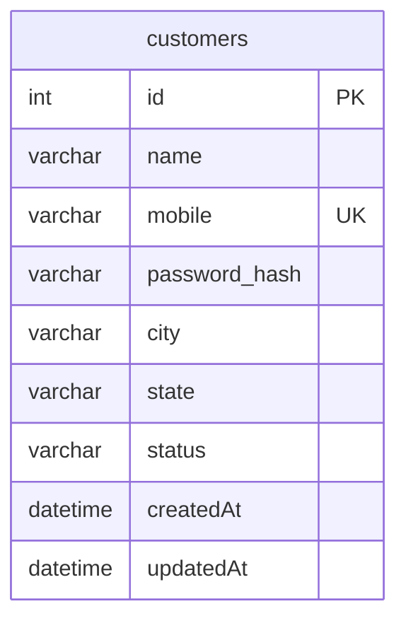
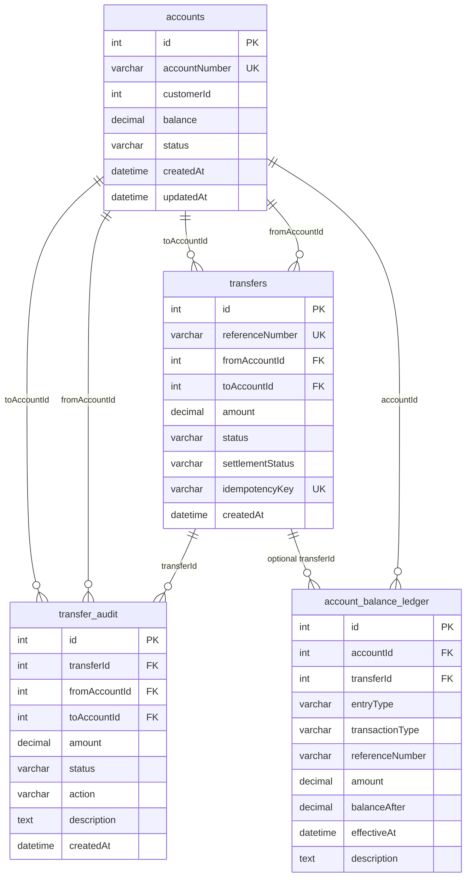
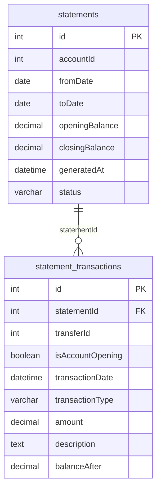
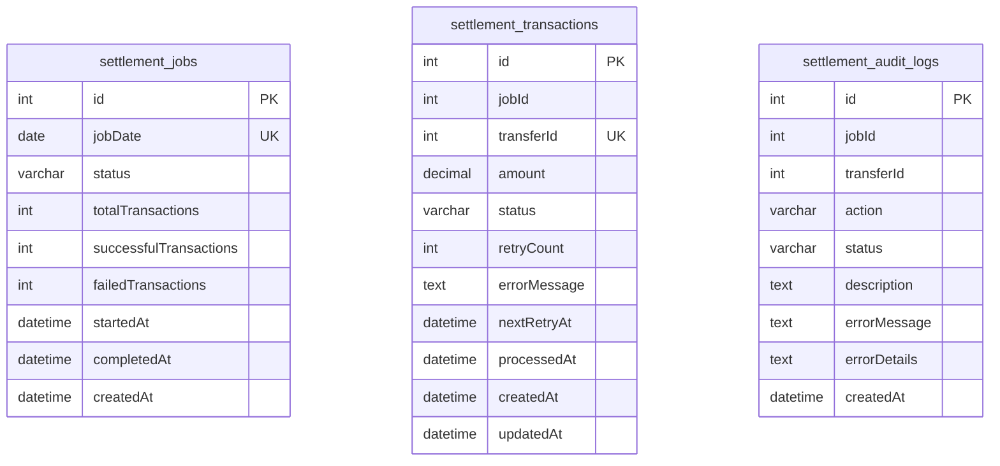

# Database Schema

This document describes the schemas established by the current TypeORM
migrations and entities in this repository. MySQL table definitions below show
the post-migration schema, including columns changed by later migrations.

## Schema Ownership and Relationship Boundaries

| Store | Owning project | Persistence model |
| --- | --- | --- |
| `customer_db` | Customer Service | MySQL / TypeORM |
| `banking_db` | Banking Service | MySQL / TypeORM |
| `statement_db` | Statement Service | MySQL / TypeORM |
| `settlement_db` | Settlement Service | MySQL / TypeORM |
| Redis Search | Search Service | Redis hashes, sets, and sorted sets |

The API Gateway has no database entities or migrations. Search Service also
has no TypeORM schema; its storage structure is described in the Redis Search
section.

**Cross-service database relationships are handled through gRPC, not through
cross-database foreign keys.** A numeric identifier stored by one service may
refer logically to a record owned by another service, but that relationship
does not create a MySQL constraint between the services' databases. For
example, Banking Service validates customer IDs by calling Customer Service;
Statement and Settlement Services use Banking Service gRPC operations for
account and transfer data.

## 1. `customer_db`

### Entity relationship diagram

`customer_db` contains one table and has no foreign-key relationships.

### Table: `customers`

| Column | MySQL type | Nullability / default | Key |
| --- | --- | --- | --- |
| `id` | `int` | `NOT NULL`, auto-increment | Primary key |
| `name` | `varchar(150)` | `NOT NULL` | — |
| `mobile` | `varchar(15)` | `NOT NULL` | Unique |
| `password_hash` | `varchar(255)` | `NULL` | — |
| `city` | `varchar(100)` | `NOT NULL` | — |
| `state` | `varchar(100)` | `NOT NULL` | — |
| `status` | `varchar(20)` | `NOT NULL`, default `'ACTIVE'` | — |
| `createdAt` | `datetime(6)` | `NOT NULL`, default `CURRENT_TIMESTAMP(6)` | — |
| `updatedAt` | `datetime(6)` | `NOT NULL`, default `CURRENT_TIMESTAMP(6)`, updates on row update | — |

**Constraints and indexes**

- Primary key: `id`.
- Unique index `IDX_6d1cb2e8c3ca15f7293464edad` on `mobile`.
- Indexes: `IDX_customers_name` (`name`), `IDX_customers_city` (`city`),
  `IDX_customers_state` (`state`), `IDX_customers_status` (`status`), and
  `IDX_customers_createdAt` (`createdAt`).
- Foreign keys: none.

The password column is nullable in the schema. The application stores password
hashes there for customers with credentials; the database migration does not
add a `NOT NULL` constraint.

**Relationship to other services:** Banking Service stores `customerId` in
`accounts` and calls Customer Service over gRPC to validate that identifier.
There is no foreign key from `banking_db` to `customer_db`.

**Source:** [Customer entity](../customer-service/src/customer/entities/customer.entity.ts);
[customer migrations](../customer-service/src/database/migrations/).

## 2. `banking_db`

### Entity relationship diagram

The diagram shows only relationships enforced by foreign keys in
`banking_db`. Customer IDs are not included as a database relationship because
the customer table is owned by Customer Service.

### Table: `accounts`

| Column | MySQL type | Nullability / default | Key |
| --- | --- | --- | --- |
| `id` | `int` | `NOT NULL`, auto-increment | Primary key |
| `accountNumber` | `varchar(30)` | `NOT NULL` | Unique |
| `customerId` | `int` | `NOT NULL` | — |
| `balance` | `decimal(15,2)` | `NOT NULL`, default `0.00` | — |
| `status` | `varchar(20)` | `NOT NULL`, default `'ACTIVE'` | — |
| `createdAt` | `datetime(6)` | `NOT NULL`, default `CURRENT_TIMESTAMP(6)` | — |
| `updatedAt` | `datetime(6)` | `NOT NULL`, default `CURRENT_TIMESTAMP(6)`, updates on row update | — |

**Constraints and indexes**

- Primary key: `id`.
- Unique index: `UQ_accounts_account_number` (`accountNumber`).
- Indexes: `IDX_accounts_customer_id` (`customerId`) and
  `IDX_accounts_status` (`status`).
- Foreign keys: none. In particular, `customerId` is not a foreign key to
  Customer Service's `customers` table.

### Table: `transfers`

| Column | MySQL type | Nullability / default | Key |
| --- | --- | --- | --- |
| `id` | `int` | `NOT NULL`, auto-increment | Primary key |
| `referenceNumber` | `varchar(50)` | `NOT NULL` | Unique |
| `fromAccountId` | `int` | `NOT NULL` | Foreign key to `accounts.id` |
| `toAccountId` | `int` | `NOT NULL` | Foreign key to `accounts.id` |
| `amount` | `decimal(15,2)` | `NOT NULL` | — |
| `status` | `varchar(20)` | `NOT NULL` | — |
| `idempotencyKey` | `varchar(100)` | `NOT NULL` | Unique |
| `createdAt` | `datetime(6)` | `NOT NULL`, default `CURRENT_TIMESTAMP(6)` | — |
| `settlementStatus` | `varchar(20)` | `NOT NULL`, default `'PENDING'` | — |

**Constraints and indexes**

- Primary key: `id`.
- Unique indexes: `UQ_transfers_reference_number` (`referenceNumber`) and
  `UQ_transfers_idempotency_key` (`idempotencyKey`).
- Indexes: `IDX_transfers_from_account_id` (`fromAccountId`),
  `IDX_transfers_to_account_id` (`toAccountId`),
  `IDX_transfers_created_at` (`createdAt`), and
  `IDX_transfers_settlement_status_created_at` (`settlementStatus`,
  `createdAt`).
- Foreign keys:
  - `FK_transfers_from_account`: `fromAccountId` references `accounts.id`;
    delete restricted, update cascades.
  - `FK_transfers_to_account`: `toAccountId` references `accounts.id`;
    delete restricted, update cascades.

The original migration creates `referenceNumber`, `status`, and
`idempotencyKey` with different lengths / enum definitions. The schema above
reflects the later `AlignBankingSchema` migration, which changes these to
`varchar(50)`, `varchar(20)`, and `varchar(100)` respectively.

### Table: `transfer_audit`

The initial migration creates `transfer_audits`; the alignment migration
renames it to `transfer_audit`.

| Column | MySQL type | Nullability / default | Key |
| --- | --- | --- | --- |
| `id` | `int` | `NOT NULL`, auto-increment | Primary key |
| `transferId` | `int` | `NOT NULL` | Foreign key to `transfers.id` |
| `fromAccountId` | `int` | `NOT NULL` | Foreign key to `accounts.id` |
| `toAccountId` | `int` | `NOT NULL` | Foreign key to `accounts.id` |
| `amount` | `decimal(15,2)` | `NOT NULL` | — |
| `status` | `varchar(20)` | `NOT NULL` | — |
| `action` | `varchar(50)` | `NOT NULL` | — |
| `description` | `text` | `NULL` | — |
| `createdAt` | `datetime(6)` | `NOT NULL`, default `CURRENT_TIMESTAMP(6)` | — |

**Constraints and indexes**

- Primary key: `id`.
- Indexes: `IDX_transfer_audit_transfer_id` (`transferId`) and
  `IDX_transfer_audit_created_at` (`createdAt`).
- Foreign keys:
  - `FK_transfer_audits_transfer`: `transferId` references `transfers.id`.
  - `FK_transfer_audits_from_account`: `fromAccountId` references
    `accounts.id`.
  - `FK_transfer_audits_to_account`: `toAccountId` references `accounts.id`.
- All three foreign keys restrict deletes and cascade updates. There are no
  unique constraints beyond the primary key.

### Table: `account_balance_ledger`

| Column | MySQL type | Nullability / default | Key |
| --- | --- | --- | --- |
| `id` | `int` | `NOT NULL`, auto-increment | Primary key |
| `accountId` | `int` | `NOT NULL` | Foreign key to `accounts.id` |
| `transferId` | `int` | `NULL` | Foreign key to `transfers.id` |
| `entryType` | `varchar(20)` | `NOT NULL` | — |
| `transactionType` | `varchar(10)` | `NULL` | — |
| `referenceNumber` | `varchar(50)` | `NULL` | — |
| `amount` | `decimal(15,2)` | `NOT NULL` | — |
| `balanceAfter` | `decimal(15,2)` | `NOT NULL` | — |
| `effectiveAt` | `datetime(6)` | `NOT NULL` | — |
| `description` | `text` | `NOT NULL` | — |

**Constraints and indexes**

- Primary key: `id`.
- Composite index: `IDX_balance_ledger_account_effective_id`
  (`accountId`, `effectiveAt`, `id`).
- Index: `IDX_balance_ledger_transfer_id` (`transferId`).
- Foreign keys:
  - `FK_balance_ledger_account`: `accountId` references `accounts.id`.
  - `FK_balance_ledger_transfer`: `transferId` references `transfers.id`.
- Both foreign keys restrict deletes and cascade updates. No additional unique
  constraints are defined.

The ledger migration inserts a baseline row for every account existing at
migration time. It does not backfill historical transfer entries.

**Source:** [Banking entities](../banking-service/src/);
[banking migrations](../banking-service/src/database/migrations/).

## 3. `statement_db`

### Entity relationship diagram

`statement_transactions.statementId` is the only database foreign key in this
schema. `accountId` and `transferId` refer to Banking Service identifiers but
are not cross-database foreign keys.

### Table: `statements`

| Column | MySQL type | Nullability / default | Key |
| --- | --- | --- | --- |
| `id` | `int` | `NOT NULL`, auto-increment | Primary key |
| `accountId` | `int` | `NOT NULL` | — |
| `fromDate` | `date` | `NOT NULL` | — |
| `toDate` | `date` | `NOT NULL` | — |
| `openingBalance` | `decimal(15,2)` | `NULL` | — |
| `closingBalance` | `decimal(15,2)` | `NULL` | — |
| `generatedAt` | `datetime` | `NULL` | — |
| `status` | `varchar(20)` | `NULL` | — |

**Constraints and indexes**

- Primary key: `id`.
- Indexes: `IDX_statements_accountId` (`accountId`),
  `IDX_statements_fromDate` (`fromDate`), `IDX_statements_toDate` (`toDate`),
  and `IDX_statements_status` (`status`).
- Foreign keys and unique constraints: none.

### Table: `statement_transactions`

| Column | MySQL type | Nullability / default | Key |
| --- | --- | --- | --- |
| `id` | `int` | `NOT NULL`, auto-increment | Primary key |
| `statementId` | `int` | `NOT NULL` | Foreign key to `statements.id` |
| `transferId` | `int` | `NULL` | — |
| `isAccountOpening` | `boolean` | `NOT NULL`, default `FALSE` | — |
| `transactionDate` | `datetime` | `NULL` | — |
| `transactionType` | `varchar(20)` | `NULL` | — |
| `amount` | `decimal(15,2)` | `NULL` | — |
| `description` | `text` | `NULL` | — |
| `balanceAfter` | `decimal(15,2)` | `NULL` | — |

**Constraints and indexes**

- Primary key: `id`.
- Indexes: `IDX_statement_transactions_statementId` (`statementId`),
  `IDX_statement_transactions_transferId` (`transferId`), and
  `IDX_statement_transactions_transactionDate` (`transactionDate`).
- Foreign key `FK_statement_transactions_statementId`: `statementId`
  references `statements.id`; delete cascades and update cascades.
- Unique constraints: none.

The account-opening migration makes `transferId` nullable and adds
`isAccountOpening`. The `transferId` value identifies a Banking Service
transfer when applicable; it has no foreign key to `banking_db`.

**Source:** [Statement entities](../statement-service/src/database/entities/);
[statement migrations](../statement-service/src/database/migrations/).

## 4. `settlement_db`

### Entity relationship diagram

The Settlement Service migrations define **no foreign keys**. `jobId` and
`transferId` provide application-level identifiers, not enforced database
relationships. They are shown as separate entities here to avoid implying
foreign-key constraints.

### Table: `settlement_jobs`

| Column | MySQL type | Nullability / default | Key |
| --- | --- | --- | --- |
| `id` | `int` | `NOT NULL`, auto-increment | Primary key |
| `jobDate` | `date` | `NOT NULL` | Unique |
| `status` | `varchar(20)` | `NOT NULL`, default `'PENDING'` | — |
| `totalTransactions` | `int` | `NOT NULL`, default `0` | — |
| `successfulTransactions` | `int` | `NOT NULL`, default `0` | — |
| `failedTransactions` | `int` | `NOT NULL`, default `0` | — |
| `startedAt` | `datetime` | `NULL` | — |
| `completedAt` | `datetime` | `NULL` | — |
| `createdAt` | `datetime` | `NOT NULL`, default `CURRENT_TIMESTAMP` | — |

**Constraints and indexes**

- Primary key: `id`.
- Unique constraint: `UQ_SETTLEMENT_JOB_DATE` (`jobDate`).
- Indexes: `IDX_SETTLEMENT_JOB_DATE` (`jobDate`) and
  `IDX_SETTLEMENT_JOB_STATUS` (`status`). The migration creates the ordinary
  `jobDate` index in addition to the unique constraint.
- Foreign keys: none.

### Table: `settlement_transactions`

| Column | MySQL type | Nullability / default | Key |
| --- | --- | --- | --- |
| `id` | `int` | `NOT NULL`, auto-increment | Primary key |
| `jobId` | `int` | `NULL` | — |
| `transferId` | `int` | `NOT NULL` | Unique |
| `amount` | `decimal(15,2)` | `NOT NULL` | — |
| `status` | `varchar(20)` | `NOT NULL`, default `'PENDING'` | — |
| `retryCount` | `int` | `NOT NULL`, default `0` | — |
| `errorMessage` | `text` | `NULL` | — |
| `nextRetryAt` | `datetime` | `NULL` | — |
| `processedAt` | `datetime` | `NULL` | — |
| `createdAt` | `datetime` | `NOT NULL`, default `CURRENT_TIMESTAMP` | — |
| `updatedAt` | `datetime` | `NOT NULL`, default `CURRENT_TIMESTAMP`, updates on row update | — |

**Constraints and indexes**

- Primary key: `id`.
- Unique constraint: `UQ_SETTLEMENT_TRANSFER_ID` (`transferId`).
- Indexes: `IDX_SETTLEMENT_TRANSACTION_STATUS` (`status`),
  `IDX_SETTLEMENT_TRANSACTION_TRANSFER_ID` (`transferId`),
  `IDX_SETTLEMENT_TRANSACTION_JOB_ID` (`jobId`), and
  `IDX_SETTLEMENT_TRANSACTION_NEXT_RETRY_AT` (`nextRetryAt`).
- Foreign keys: none. `jobId` is not constrained to `settlement_jobs.id`;
  `transferId` is a Banking Service identifier and is not constrained to
  `banking_db`.

### Table: `settlement_audit_logs`

| Column | MySQL type | Nullability / default | Key |
| --- | --- | --- | --- |
| `id` | `int` | `NOT NULL`, auto-increment | Primary key |
| `jobId` | `int` | `NOT NULL` | — |
| `transferId` | `int` | `NULL` | — |
| `action` | `varchar(50)` | `NOT NULL` | — |
| `status` | `varchar(20)` | `NOT NULL` | — |
| `description` | `text` | `NOT NULL` | — |
| `errorMessage` | `text` | `NULL` | — |
| `errorDetails` | `text` | `NULL` | — |
| `createdAt` | `datetime` | `NOT NULL`, default `CURRENT_TIMESTAMP` | — |

**Constraints and indexes**

- Primary key: `id`.
- Indexes: `IDX_SETTLEMENT_AUDIT_JOB_ID` (`jobId`),
  `IDX_SETTLEMENT_AUDIT_TRANSFER_ID` (`transferId`), and
  `IDX_SETTLEMENT_AUDIT_CREATED_AT` (`createdAt`).
- Foreign keys and unique constraints: none. `jobId` and `transferId` are
  application-level references only.

**Source:** [Settlement entities](../settlement-service/src/);
[settlement migrations](../settlement-service/src/database/migrations/).

## 5. Redis Search Structure

Search Service uses standard Redis hashes, sets, and sorted sets. The
implementation does not declare Redis Stack Search indexes or a separate
RedisSearch schema. Search values are normalized by trimming whitespace and
lowercasing with the `en` locale. Sorted-set members use a score of `0` and
the format `normalizedValue|customerId`; lexicographical range queries support
prefix matching.

### Customer hashes

- Key pattern: `search:customer:<id>`.
- Hash fields written by the seed utility: `id`, `name`, `mobile`, `city`,
  `state`, `status`.
- The `<id>` is a customer identifier string. The deterministic seed utility
  uses values such as `customer-00001`.
- The search service reads the `name`, `city`, `state`, `mobile`, and `status`
  hash fields for matching IDs.

### Sorted-set indexes

| Key | Indexed field | Member format |
| --- | --- | --- |
| `search:index:customer:name` | `name` | `<normalized name>\|<customerId>` |
| `search:index:customer:mobile` | `mobile` | `<normalized mobile>\|<customerId>` |
| `search:index:customer:city` | `city` | `<normalized city>\|<customerId>` |
| `search:index:customer:state` | `state` | `<normalized state>\|<customerId>` |

Each member is inserted with sorted-set score `0`. The Lua search routine
queries each index with `ZRANGEBYLEX`, unions and deduplicates IDs, verifies
the corresponding customer hash exists, and then loads the limited set of
customer hashes.

### Seed tracking set

- Key: `search:customer:seed:ids`.
- Type: Redis set.
- Contents: IDs added by the deterministic customer seeding utility. The
  utility uses this set to delete only its previously seeded hashes, clears
  the four known index keys, and then writes the seed data again.

**Source:** [Search key constants and search query](../search-service/src/search/search.constants.ts);
[seed utility](../search-service/scripts/seed-customers.ts);
[search service](../search-service/src/search/search.service.ts).

## 6. Cross-Service Relationships

| Logical association | Persisted fields | How the relationship is handled |
| --- | --- | --- |
| Account to customer | `banking_db.accounts.customerId` | Banking Service calls Customer Service gRPC to validate the customer when creating an account; no cross-database foreign key exists. |
| Statement to account / transfer | `statement_db.statements.accountId`, `statement_transactions.transferId` | Statement Service requests account details and transaction history from Banking Service gRPC; these IDs are not foreign keys into `banking_db`. |
| Settlement transaction to transfer | `settlement_db.settlement_transactions.transferId` | Settlement Service obtains pending transfers and updates their settlement status through Banking Service gRPC; no foreign key crosses into `banking_db`. |
| Settlement rows to job | `settlement_transactions.jobId`, `settlement_audit_logs.jobId` | These fields are application-level job identifiers. Current migrations define no foreign keys to `settlement_jobs`. |
| Search index to customer | Hash IDs and sorted-set members in Redis | Search data is held in Redis, separate from `customer_db`; the search schema itself contains no relational foreign keys. |

Only relationships explicitly created by migrations are database-enforced.
Logical identifiers shared between microservices do not imply cross-database
foreign-key constraints.
